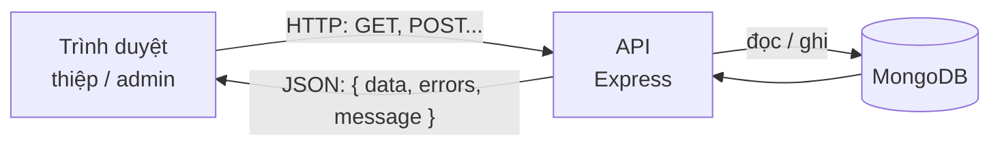
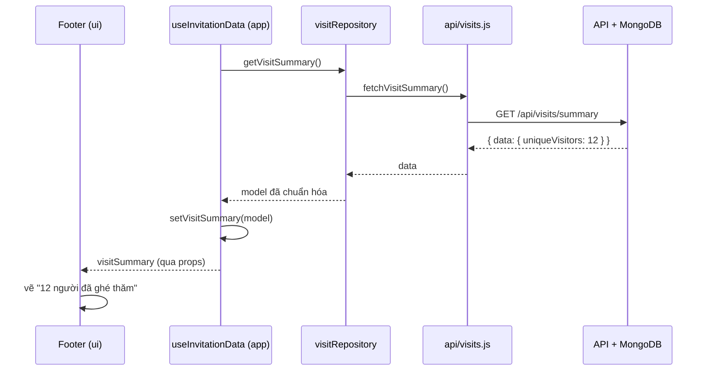
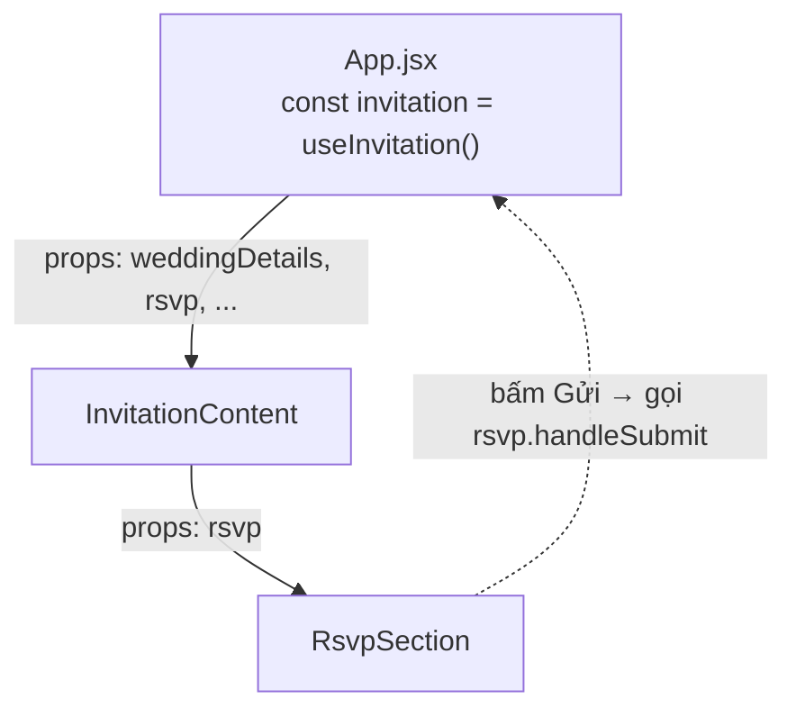

# Hướng dẫn cấu trúc dự án cho người mới học web

Tài liệu này giải thích dự án thiệp cưới chạy thế nào, theo đúng code đang có. Đọc từ trên xuống. Mỗi phần đều chỉ file thật để bạn mở ra đối chiếu.

## 1. Bức tranh tổng thể

Dự án có 3 phần chạy riêng:

| Phần | Thư mục | Là gì | Chạy ở |
|---|---|---|---|
| Thiệp | `apps/wedding-invitation` | Trang web khách mời xem (React) | Trình duyệt của khách |
| Admin | `apps/admin` | Trang quản lý của cô dâu chú rể (React) | Trình duyệt của bạn |
| API | `apps/api` | Máy chủ nhận và trả dữ liệu (Node.js + Express) | Máy chủ |

Dữ liệu (hồi đáp, ảnh, nhạc, lượt xem…) nằm trong **MongoDB** (cơ sở dữ liệu). Trình duyệt **không** nói chuyện trực tiếp với MongoDB, mà luôn hỏi qua API:



Mọi câu trả lời của API đều có cùng một dạng, gọi là **envelope** (phong bì):

```json
{ "data": { "uniqueVisitors": 12, "totalVisits": 30 }, "errors": [], "message": "Số người đã xem thiệp." }
```

- `data`: dữ liệu bạn cần (khi lỗi thì là `null`).
- `errors`: danh sách lỗi, ví dụ `{ "field": "name", "message": "Vui lòng nhập họ và tên." }`.
- `message`: câu thông báo chung.

## 2. Vì sao chia code thành nhiều tầng

Trong `apps/wedding-invitation/src` (admin cũng giống vậy), code chia theo **việc nó làm**:

| Thư mục | Việc duy nhất của nó | Ví dụ thực tế |
|---|---|---|
| `api/` | Gọi API bằng `fetch`, mở phong bì lấy `data` | Người đưa thư |
| `models/` | Chuẩn hóa dữ liệu thô thành dạng dễ dùng | Người phân loại thư |
| `repositories/` | Nơi **duy nhất** cung cấp dữ liệu (từ API hoặc khai báo sẵn) | Quầy giao dịch |
| `app/` | Giữ **state** (trạng thái) và xử lý nghiệp vụ bằng hook | Bộ não |
| `ui/` | Chỉ vẽ giao diện từ dữ liệu nhận được | Mặt tiền cửa hàng |

Lợi ích: khi API đổi địa chỉ, chỉ sửa `api/`; khi đổi giao diện, chỉ sửa `ui/`; không phải lục khắp nơi.

## 3. Ví dụ 1: Đọc dữ liệu. "Bao nhiêu người đã xem thiệp?"

Ở chân trang thiệp có dòng "👁 12 người đã ghé thăm thiệp". Ta đi theo con số này từ MongoDB lên màn hình.

### Bước 1: API trả dữ liệu (`apps/api/src/routes/visits.js`)

API có một "đường dẫn" `GET /api/visits/summary`: đếm trong MongoDB rồi trả về phong bì `{ data: { uniqueVisitors, totalVisits } }`.

### Bước 2: `api/`: gọi API (`src/api/visits.js`)

```js
export async function fetchVisitSummary() {
  const response = await fetch(`${apiUrl}/api/visits/summary`); // 1. gửi yêu cầu
  const result = await response.json().catch(() => null);      // 2. đọc JSON
  if (!response.ok || !result || !Object.hasOwn(result, "data")) {
    throw new Error(result?.message ?? "Không tải được số người đã xem."); // 3. lỗi thì ném ra
  }
  return result.data;                                           // 4. mở phong bì, lấy data
}
```

- `fetch(url)` gửi yêu cầu HTTP. Việc này mất thời gian (phải chờ mạng), nên nó trả về một **Promise**, tức một "lời hứa sẽ có kết quả sau".
- `await` nghĩa là "chờ lời hứa này xong rồi mới chạy dòng tiếp theo". Chỉ dùng được bên trong hàm có chữ `async`.
- `throw new Error(...)` báo lỗi lên cho nơi gọi hàm xử lý.

### Bước 3: `models/`: chuẩn hóa (`src/models/VisitSummary.js`)

```js
export function createVisitSummaryModel(data = {}) {
  return {
    uniqueVisitors: Number(data.uniqueVisitors ?? 0),
    totalVisits: Number(data.totalVisits ?? 0),
  };
}
```

`??` nghĩa là "nếu bên trái không có (null/undefined) thì dùng bên phải". Nhờ vậy dù API thiếu trường, giao diện vẫn nhận được số 0 chứ không bị lỗi.

### Bước 4: `repositories/`: ghép lại (`src/repositories/visitRepository.js`)

```js
export async function getVisitSummary() {
  return createVisitSummaryModel(await fetchVisitSummary());
}
```

Từ đây trở lên, phần còn lại của app chỉ cần gọi `getVisitSummary()`. Nó không cần biết bên dưới là API hay dữ liệu viết sẵn.

### Bước 5: `app/`: lưu vào state (`src/app/useInvitationData.js`, chỉ trích phần lượt xem)

```js
const [visitSummary, setVisitSummary] = useState(null); // ban đầu chưa có gì

useEffect(() => {
  recordVisit()                 // ghi 1 lượt xem
    .catch(() => {})            // lỗi thì bỏ qua
    .then(getVisitSummary)      // rồi lấy số đếm
    .then(setVisitSummary)      // có kết quả → lưu vào state
    .catch(() => {});           // lỗi thì thiệp vẫn chạy, chỉ không hiện số
}, []);
```

Đây là hai hook quan trọng nhất của React, xem giải thích ở **phần 4**.

### Bước 6: `ui/`: hiển thị (`src/ui/layout/Footer.jsx`, đã rút gọn)

```jsx
function Footer({ weddingDetails, visitSummary }) {
  return (
    <footer>
      {visitSummary && (
        <p className="visit-count">
          <strong>{visitSummary.uniqueVisitors}</strong> người đã ghé thăm thiệp
        </p>
      )}
    </footer>
  );
}
```

`visitSummary && (...)` nghĩa là: **chỉ vẽ** đoạn này khi `visitSummary` đã có giá trị. Lúc đầu là `null` nên chưa vẽ; khi API trả về thì tự hiện ra.

Toàn bộ chuyến đi:



## 4. `useState` và `useEffect` giải thích dễ hiểu

### `useState`: "trí nhớ" của component

```js
const [visitSummary, setVisitSummary] = useState(null);
```

- `visitSummary`: giá trị hiện tại (lúc đầu là `null`).
- `setVisitSummary(x)`: hàm để **đổi** giá trị. Gọi nó thì React **vẽ lại** giao diện với giá trị mới.
- Không được gán trực tiếp `visitSummary = 5`: React sẽ không biết để vẽ lại.

Khi giá trị mới phụ thuộc giá trị cũ, truyền vào một hàm:

```js
setForm((current) => ({ ...current, name: "Lan" })); // giữ nguyên các ô khác, chỉ đổi name
```

`...current` (spread) nghĩa là "chép hết các trường cũ", sau đó ghi đè trường `name`.

### `useEffect`: "làm việc này sau khi vẽ xong"

```js
useEffect(() => {
  // việc cần làm: gọi API, hẹn giờ, lắng nghe sự kiện…
  return () => { /* dọn dẹp khi component bị gỡ (không bắt buộc) */ };
}, [/* danh sách phụ thuộc */]);
```

| Danh sách phụ thuộc | Khi nào chạy |
|---|---|
| `[]` | Chỉ **một lần** sau lần vẽ đầu tiên (hay dùng để tải dữ liệu) |
| `[music]` | Lần đầu, và **mỗi khi `music` đổi** |
| bỏ trống | Sau **mọi** lần vẽ (hiếm khi cần) |

Ví dụ thật: `src/app/useBackgroundMusic.js` dùng `[music]`: có bài nhạc mới thì tạo trình phát mới, và phần `return` dọn trình phát cũ.

> Vì sao không gọi API thẳng trong thân component? Vì mỗi lần vẽ lại, code trong thân chạy lại, dẫn tới gọi API liên tục. `useEffect` với `[]` đảm bảo chỉ gọi một lần.

## 5. Ví dụ 2: Gửi dữ liệu. Form "Bạn sẽ đến chứ?"

File: `src/app/useRsvpForm.js` (logic) và `src/ui/sections/RsvpSection.jsx` (giao diện).

### Ô nhập "có kiểm soát" (controlled input)

```js
const [form, setForm] = useState({ name: "", phone: "", attendance: "attending", guests: "1", note: "" });

function updateField(event) {
  const { name, value } = event.target;          // ô nào? gõ gì?
  setForm((current) => ({ ...current, [name]: value }));
}
```

```jsx
<input name="name" value={form.name} onChange={updateField} />
```

Mỗi lần gõ một chữ: `onChange` → `updateField` → `setForm` → React vẽ lại → ô hiện chữ mới. Giá trị trong ô **luôn bằng** `form.name`, nên gọi là "có kiểm soát".

### Gửi form (đã rút gọn, file thật có thêm hẹn giờ cho hiệu ứng và tải lại lời chúc)

```js
async function handleSubmit(event) {
  event.preventDefault();                 // chặn trình duyệt tải lại trang
  const errors = validateRsvp(form);      // kiểm tra trước khi gửi
  setFieldErrors(errors);
  if (Object.keys(errors).length > 0) return;

  setSubmitting(true);                    // khóa nút "Gửi", hiện "Đang gửi..."
  try {
    await submitRsvp(form);               // POST /api/rsvps (qua repository)
    setForm(initialRsvpForm);             // thành công: xóa form
    setIsLetterFlying(true);              // chạy hiệu ứng lá thư bay
  } catch (error) {
    setMessage(error.message);            // thất bại: hiện lỗi cho khách
  } finally {
    setSubmitting(false);                 // dù thành công hay lỗi cũng mở khóa nút
  }
}
```

- `try { … } catch { … } finally { … }`: thử làm, nếu lỗi thì xử lý ở `catch`, cuối cùng **luôn** chạy `finally`.
- `submitting` là một state kiểu đúng/sai (boolean) dùng để khóa nút: `<button disabled={submitting}>`. Nhờ vậy khách không bấm gửi hai lần.

## 6. Props: dữ liệu chảy xuống, sự kiện chảy lên



- **Props** là "tham số" truyền từ component cha xuống con: `<Footer visitSummary={visitSummary} />`.
- Con **không sửa** props. Muốn thay đổi thì gọi **hàm** cha truyền xuống (ví dụ `onClick={gift.toggle}`), cha đổi state rồi truyền giá trị mới xuống lại.
- Hook tổng `src/app/useInvitation.js` gom state của từng phần (bìa, nhạc, hồi đáp, hộp quà…), còn `App.jsx` chỉ nối hook với giao diện.

## 7. Tự làm thử: hiện thêm "tổng lượt xem" ở chân trang

API đã trả sẵn `totalVisits`, model cũng đã có trường này. Bạn chỉ cần sửa **một file giao diện**:

1. Mở `src/ui/layout/Footer.jsx`.
2. Sau dòng số người, thêm: `· {visitSummary.totalVisits} lượt xem`.
3. Lưu file. Vite tự tải lại trang, bạn sẽ thấy ngay.

Muốn thêm một **mục mới** cho thiệp, làm theo 4 bước ở mục "Thêm một mục mới vào thiệp" trong [`CLAUDE.md`](../CLAUDE.md).

## 8. Mẹo tìm lỗi

- **F12 → tab Network:** xem từng lần gọi API, gồm địa chỉ, mã trạng thái (200 là thành công, 400 là dữ liệu sai, 401 là thiếu quyền, 500 là lỗi máy chủ) và nội dung phong bì trả về.
- **F12 → tab Console:** xem lỗi JavaScript màu đỏ. Bạn có thể tạm thêm `console.log(giaTri)` để in ra giá trị.
- **Tiện ích React Developer Tools** (Chrome/Edge): xem props và state của từng component đang chạy.
- **Kiểm tra API riêng:** mở `http://localhost:4000/api/health`. Nếu thấy `"database":"connected"` là API và MongoDB đã sẵn sàng.

## 9. Từ điển nhỏ

| Thuật ngữ | Nghĩa |
|---|---|
| API | "Cửa sổ" của máy chủ để trang web hỏi và gửi dữ liệu |
| HTTP GET / POST / PUT / DELETE | Lấy / tạo mới / cập nhật / xóa dữ liệu |
| JSON | Dạng văn bản để trao đổi dữ liệu: `{ "ten": "Lan" }` |
| Promise | Lời hứa sẽ có kết quả sau (vì phải chờ mạng) |
| `async` / `await` | Viết code chờ Promise trông như code chạy tuần tự |
| Component | Một mảnh giao diện viết bằng hàm React, ví dụ `Footer` |
| Props | Tham số truyền từ component cha xuống con |
| State | Dữ liệu component "nhớ"; đổi state thì giao diện vẽ lại |
| Hook | Hàm bắt đầu bằng `use…` (`useState`, `useEffect`, `useRsvpForm`…) |
| Envelope | Dạng trả về chung của API: `{ data, errors, message }` |
